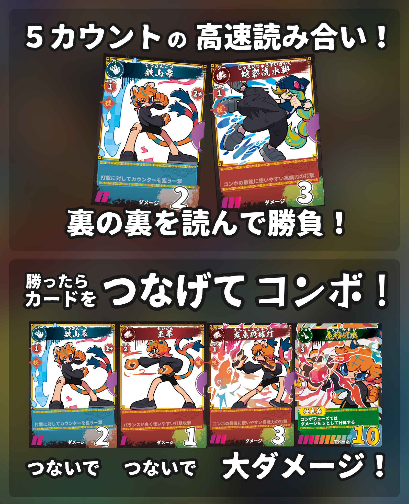
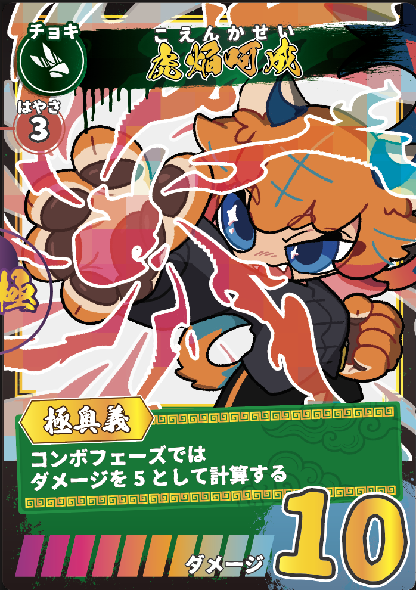
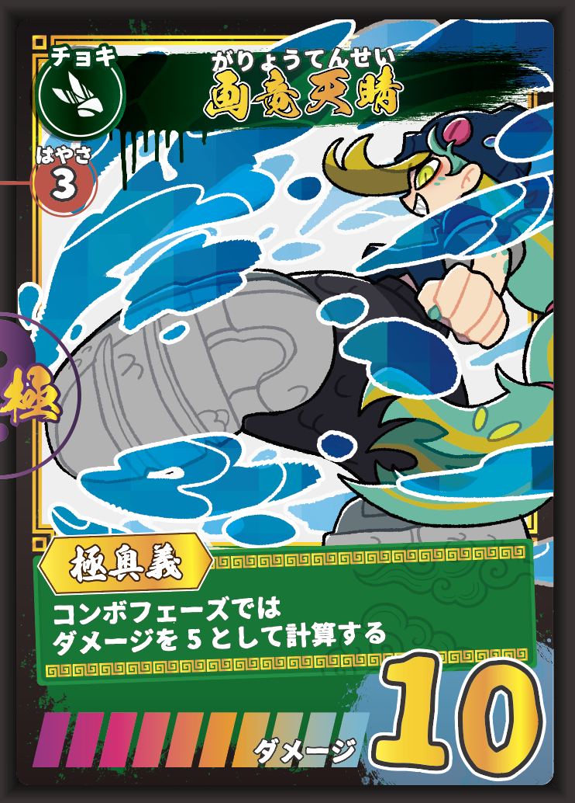
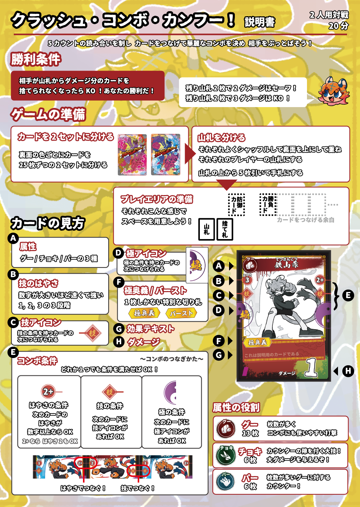
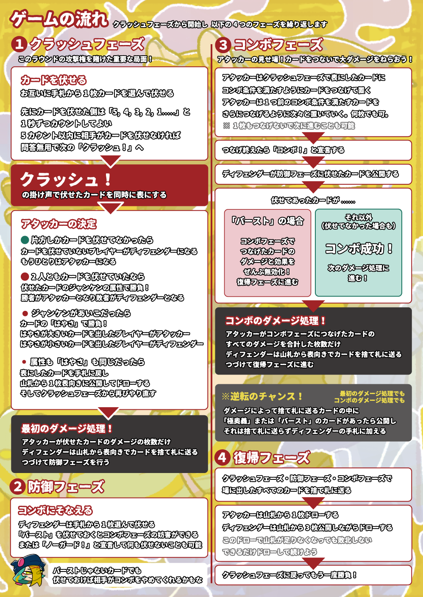

## 5カウントの読み合いを制して、コンボをつなげる

お互いに手札から 1 枚を選んで伏せます。先に伏せた側は「5, 4, 3, 2, 1」とカウントでき、5 カウント以内に相手が伏せなければそのまま勝負に進みます。刻々と変わる相手の手札の、裏の裏を読んで勝負しましょう。

読み勝ったら、カードを次々とつなげてコンボを発動します。つなげるほど大きなダメージを狙えますが、そのぶん手札は減っていきます。

## 3すくみと技の速さで主導権を奪い合う

「打撃」「崩し」「カウンター」の 3 すくみと技の速さで、攻防の主導権を奪い合います。

カードの属性はグー・チョキ・パーの 3 種類。伏せたカードのジャンケンで勝ったほうがアタッカーになり、あいこなら技の「はやさ」が大きいほうがアタッカーになります。はやさは 1・2・3 の 3 段階で、数字が大きいほど速くて強い技です。

## 切り札の「極奥義」

「極奥義」は 1 枚しかない特別な切り札です。コンボの中ではダメージを 5 として計算します。

ダメージで捨て札に送るカードの中に「極奥義」があれば、捨て札に送らずに手札に加えられます。相手の切り札を見抜けるかどうかが勝負の分かれ目です。

## 遊び方

2 人用、1 ゲーム 15〜20 分。相手が山札からダメージ分のカードを捨てられなくなったら KO、あなたの勝ちです。クラッシュフェーズ・防御フェーズ・コンボフェーズ・復帰フェーズの 4 つを繰り返して進みます。

