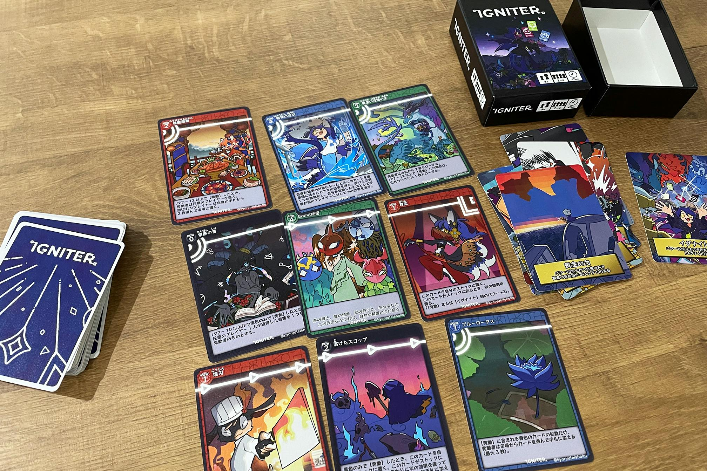
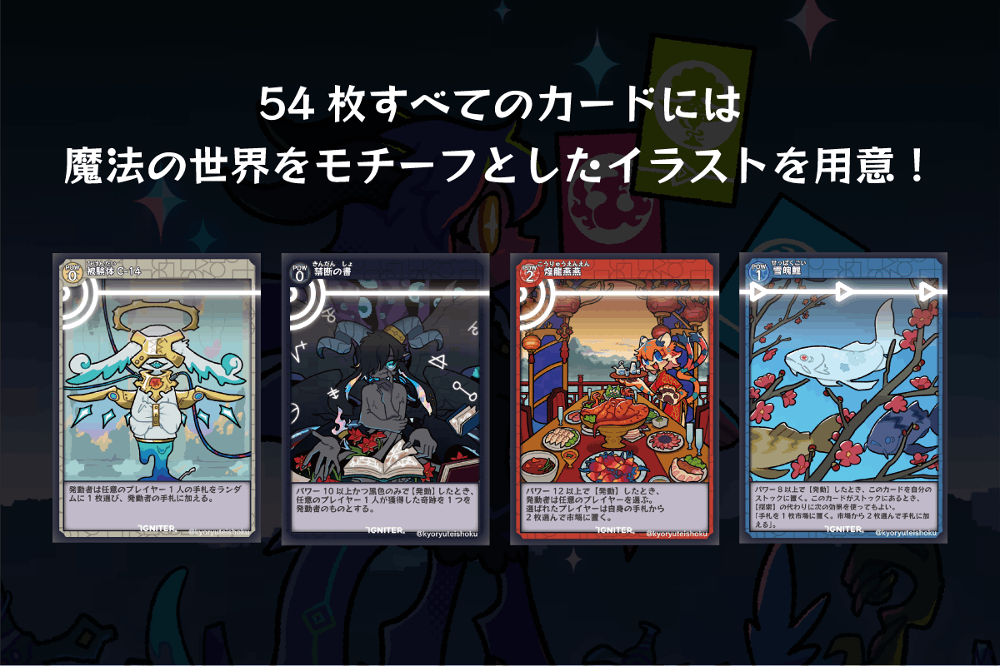

## カードを交換して集め、つなげて魔法を発動する

最大 4 人で遊べる対戦ボードゲームです。手札のカードをお互いに交換しながら必要なカードを集め、先に条件を達成したプレイヤーが勝利します。

カードをつなげて魔法を発動すると、相手の手札を封じたり、自分のデッキを強化したりと、多彩な効果を場に及ぼせます。

## 54枚すべてにイラスト

54 枚すべてのカードに、魔法の世界をモチーフにしたイラストを描いています。

